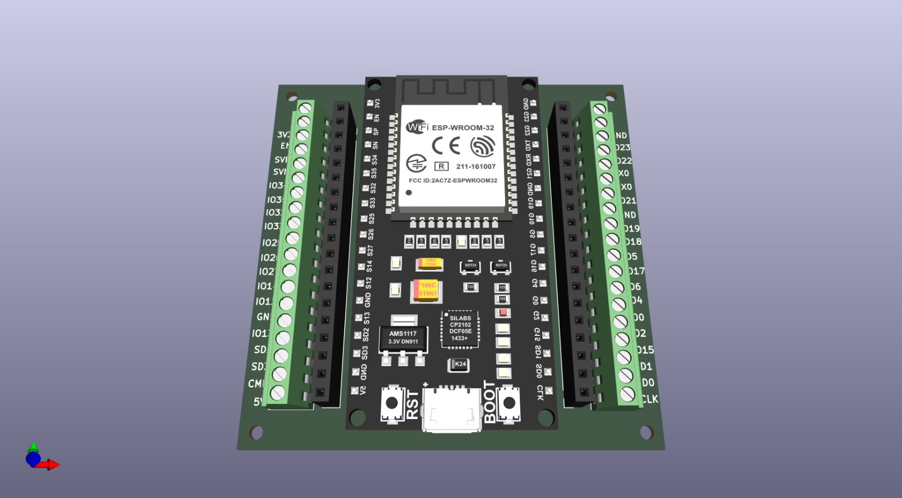
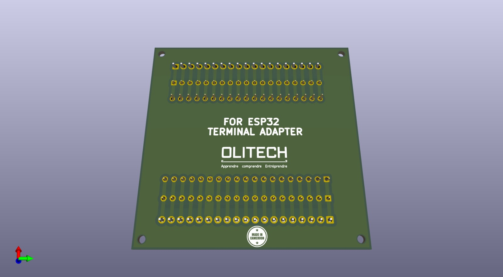
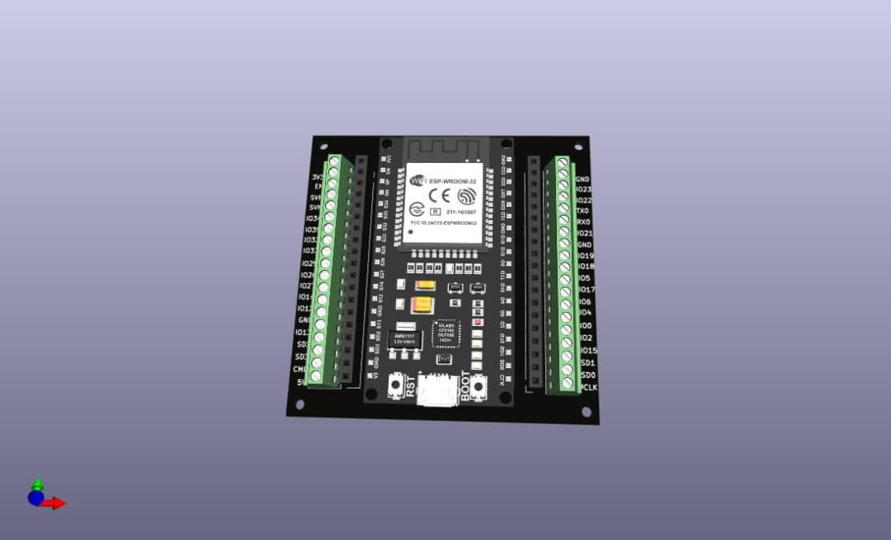

# Terminal Adapter for ESP32

**OLITECH · Conception d'une carte d'adaptation pour ESP32 DevKitC-32D**

*Design of an ESP32 terminal adapter board to simplify connections to sensors and peripherals.*

---

**Marque / Brand:** OLITECH  
**Concepteur / Designer:** OLI OLI DONALD  
**Pays / Country:** Cameroun / Cameroon  
**Carte compatible / Compatible board:** ESP32 DevKitC-32D  
**Logiciel de conception / Design software:** KiCad  

## Table des matières / Table of contents

- [🇫🇷 Français](#-français)
  - [Présentation](#présentation)
  - [Objectifs du projet](#objectifs-du-projet)
  - [Architecture et principe de conception](#architecture-et-principe-de-conception)
  - [Caractéristiques techniques](#caractéristiques-techniques)
  - [Travaux de conception réalisés](#travaux-de-conception-réalisés)
  - [Galerie du projet](#galerie-du-projet)
  - [Documents techniques](#documents-techniques)
  - [État et limites du projet](#état-et-limites-du-projet)
- [🇬🇧 English](#-english)
  - [Overview](#overview)
  - [Project objectives](#project-objectives)
  - [Architecture and design principle](#architecture-and-design-principle)
  - [Technical specifications](#technical-specifications)
  - [Design work completed](#design-work-completed)
  - [Project gallery](#project-gallery)
  - [Technical documentation](#technical-documentation)
  - [Project status and limitations](#project-status-and-limitations)
- [Contact](#contact)

---

## 🇫🇷 Français

### Présentation

**Terminal Adapter for ESP32** est un projet de conception d'une carte électronique d'adaptation destinée à faciliter le raccordement des broches d'une carte de développement **ESP32 DevKitC-32D**.

La carte est conçue pour reporter les connexions de l'ESP32 vers des borniers à vis disposés sur les deux côtés du circuit imprimé. Cette organisation rend les broches d'alimentation, de masse et d'entrées/sorties plus accessibles pour le raccordement de capteurs, de modules électroniques et de périphériques externes.

Le schéma électronique, le circuit imprimé et les vues 3D ont été conçus avec **KiCad**.

Le projet est actuellement au stade de conception numérique. La carte n'a pas encore été fabriquée physiquement, assemblée ni testée.

### Objectifs du projet

- Faciliter l'accès aux broches de la carte ESP32 DevKitC-32D.
- Simplifier le raccordement des capteurs et des périphériques externes.
- Organiser les connexions à l'aide de borniers à vis.
- Améliorer la lisibilité et la maintenance du câblage.
- Disposer d'une interface d'adaptation pratique pour les projets de prototypage à base d'ESP32.

### Architecture et principe de conception

La conception repose sur une carte intermédiaire destinée à accueillir une carte ESP32 DevKitC-32D et à reporter ses connexions vers des borniers accessibles.

Les principaux éléments de la conception sont :

- **Interface ESP32 :** empreintes et connexions prévues pour la carte de développement compatible.
- **Borniers à vis :** points de raccordement destinés aux fils des capteurs et périphériques.
- **Entrées/sorties :** report des broches GPIO accessibles sur la carte ESP32.
- **Alimentation :** accès aux lignes d'alimentation et de masse disponibles.
- **Implantation :** organisation des borniers sur les deux côtés de la carte.
- **Fixation mécanique :** quatre trous de montage prévus aux angles du PCB.

### Caractéristiques techniques

| Paramètre | Description |
|---|---|
| Nom du projet | Terminal Adapter for ESP32 |
| Type de projet | Conception d'une carte d'adaptation |
| Carte compatible | ESP32 DevKitC-32D |
| Microcontrôleur de la carte principale | ESP32 |
| Logiciel de conception | KiCad |
| Schéma électronique | Conçu |
| Circuit imprimé (PCB) | Conçu et routé |
| Type de raccordement | Borniers à vis |
| Organisation des connexions | Deux rangées latérales |
| Fixation mécanique | Quatre trous de montage |
| Application | Facilitation du câblage et du prototypage |

### Travaux de conception réalisés

- Conception du schéma électronique.
- Conception et routage du circuit imprimé.
- Organisation des connexions de l'ESP32 vers les borniers.
- Réalisation des vues 3D du PCB.
- Préparation des documents techniques.
- Étude d'une disposition de plusieurs cartes sur un même panneau de fabrication.

### Galerie du projet

Les images suivantes présentent les différentes vues de la conception numérique réalisée sous KiCad.

#### Vues 3D de la carte

| Vue 3D principale | Vue 3D arrière |
|---|---|
|  |  |

| Vue 3D en perspective | Vue 3D complémentaire |
|---|---|
|  |  |

| Vue 3D initiale |
|---|
|  |

#### Vues du circuit imprimé

| PCB – face supérieure | PCB – face inférieure |
|---|---|
|  |  |

#### Étude de panélisation

| Panélisation – face composants | Panélisation – face arrière |
|---|---|
|  |  |

Les images illustrent la conception 3D, le circuit imprimé et l'étude de panélisation. Elles ne représentent pas une carte physiquement fabriquée.

### Documents techniques

Les documents techniques sont regroupés dans le répertoire [documents/](documents/).

| Document | Description |
|---|---|
| [Schéma électronique (PDF)](documents/SCHEMATIC%20TERMINAL%20ADAPTER%20FOER%20ESP32.pdf) | Schéma électronique de la carte adaptatrice |
| [Côté composants (PDF)](documents/COTE%20COMPOSANT%20TERMINAL%20ADAPTER%20FOER%20ESP32.pdf) | Vue d'implantation côté composants |
| [Typon du PCB (PDF)](documents/TYPON%20%20TERMINAL%20ADAPTER%20FOER%20ESP32.pdf) | Dessin du circuit imprimé destiné à la fabrication |

### État et limites du projet

| Élément | État |
|---|---|
| Conception du schéma électronique | Réalisée |
| Conception du PCB | Réalisée |
| Routage du circuit imprimé | Réalisé |
| Vues 3D | Réalisées |
| Documentation technique | Disponible |
| Fabrication physique | Non réalisée |
| Assemblage des composants | Non réalisé |
| Essais sur prototype physique | Non réalisés |
| Validation expérimentale | Non réalisée |

> **Important :** ce projet est actuellement au stade de conception numérique. Les images et les documents présentés montrent le travail de conception sous KiCad. Ils ne constituent pas une preuve de fabrication physique ou de fonctionnement de la carte.

---

## 🇬🇧 English

### Overview

**Terminal Adapter for ESP32** is a PCB design project intended to simplify connections to an **ESP32 DevKitC-32D** development board.

The adapter board is designed to bring the ESP32 connections out to screw terminal blocks arranged along both sides of the PCB. This layout makes power, ground and GPIO connections more accessible when wiring sensors, electronic modules and external peripherals.

The electronic schematic, PCB layout and 3D views were designed using **KiCad**.

The project is currently at the digital design stage. The board has not yet been physically manufactured, assembled or tested.

### Project objectives

- Provide easier access to ESP32 DevKitC-32D pins.
- Simplify connections to external sensors and peripherals.
- Organize wiring through screw terminal blocks.
- Improve wiring readability and maintenance.
- Provide a practical adapter interface for ESP32-based prototyping projects.

### Architecture and design principle

The design is based on an intermediate board intended to accommodate an ESP32 DevKitC-32D development board and bring its connections out to accessible terminal blocks.

The main design elements include:

- **ESP32 interface:** footprints and connections intended for the compatible development board.
- **Screw terminal blocks:** connection points for sensor and peripheral wires.
- **Input/output:** breakout of the ESP32 GPIO connections.
- **Power supply:** access to available power and ground lines.
- **Layout:** terminal blocks arranged along both sides of the board.
- **Mechanical mounting:** four mounting holes located at the PCB corners.

### Technical specifications

| Parameter | Description |
|---|---|
| Project name | Terminal Adapter for ESP32 |
| Project type | Adapter board design |
| Compatible board | ESP32 DevKitC-32D |
| Main board microcontroller | ESP32 |
| Design software | KiCad |
| Electronic schematic | Designed |
| Printed circuit board (PCB) | Designed and routed |
| Connection type | Screw terminal blocks |
| Connection arrangement | Two side rows |
| Mechanical mounting | Four mounting holes |
| Application | Simplified wiring and prototyping |

### Design work completed

- Electronic schematic design.
- PCB design and routing.
- Organization of ESP32 connections to the terminal blocks.
- PCB 3D visualization.
- Preparation of technical documentation.
- Study of a multi-board panel layout.

### Project gallery

The following images show different views of the digital design created using KiCad.

#### 3D views of the board

| Main 3D view | Rear 3D view |
|---|---|
|  |  |

| Perspective 3D view | Additional 3D view |
|---|---|
|  |  |

| Initial 3D view |
|---|
|  |

#### PCB layout views

| PCB – component side | PCB – rear side |
|---|---|
|  |  |

#### Panelization study

| Panelization – component side | Panelization – rear side |
|---|---|
|  |  |

The images illustrate the 3D design, PCB layout and panelization study. They do not represent a physically manufactured board.

### Technical documentation

The technical documents are stored in the [documents/](documents/) directory.

| Document | Description |
|---|---|
| [Electronic schematic (PDF)](documents/SCHEMATIC%20TERMINAL%20ADAPTER%20FOER%20ESP32.pdf) | Adapter board electronic schematic |
| [Component side (PDF)](documents/COTE%20COMPOSANT%20TERMINAL%20ADAPTER%20FOER%20ESP32.pdf) | Component-side placement view |
| [PCB artwork (PDF)](documents/TYPON%20%20TERMINAL%20ADAPTER%20FOER%20ESP32.pdf) | Printed circuit board artwork for manufacturing |

### Project status and limitations

| Item | Status |
|---|---|
| Electronic schematic design | Completed |
| PCB design | Completed |
| PCB routing | Completed |
| 3D views | Completed |
| Technical documentation | Available |
| Physical manufacturing | Not performed |
| Component assembly | Not performed |
| Physical prototype testing | Not performed |
| Experimental validation | Not performed |

> **Important:** this project is currently at the digital design stage. The images and documents show the KiCad design work. They do not demonstrate physical manufacturing or operation of the board.

---

## Contact

**OLI OLI DONALD · OLITECH**  
Cameroon  

*OLITECH — Electronic design and practical engineering.*
